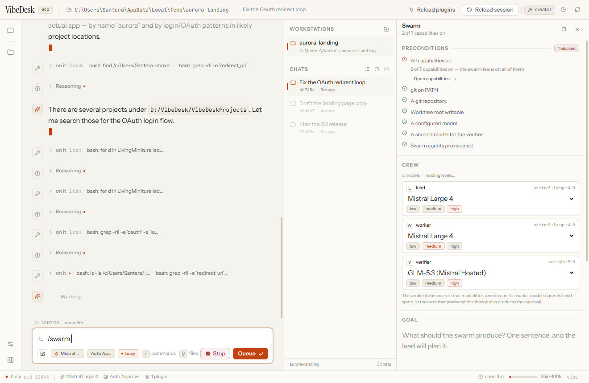
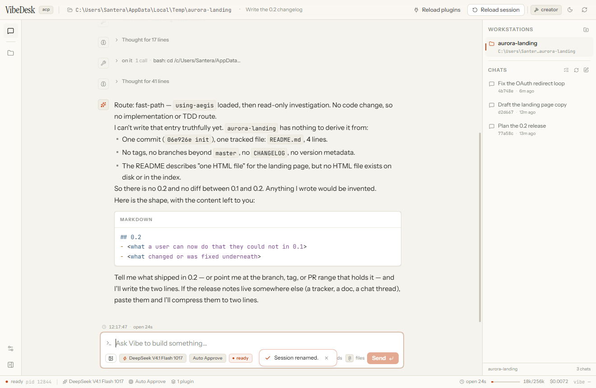
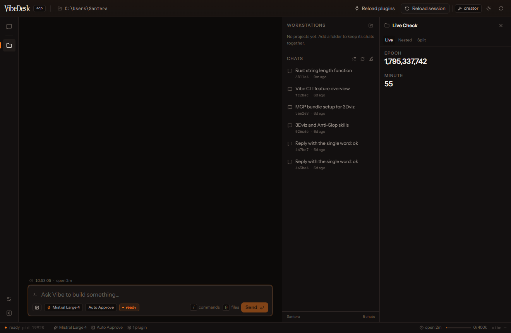
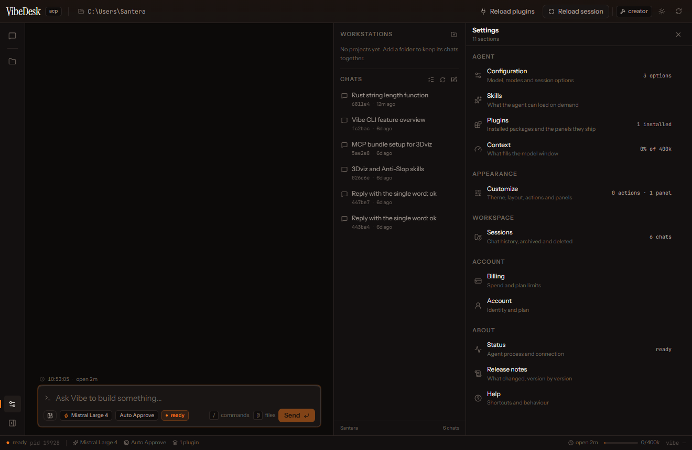

# VibeDesk

VibeDesk is a desktop app for the Mistral Vibe agent. It runs the same official
`vibe-acp` binary the `vibe` CLI uses and talks to it over the Agent Client
Protocol, so the app and your terminal always run the same agent. It does not
bundle or reimplement the agent: your `~/.vibe` config, plugins, skills and API
keys are the ones the app uses.

```
React 19 + Tailwind v4  <-- JSON-RPC over stdio -->  vibe-acp (Python)
        |                                                      |
        +------ Tauri IPC (invoke + events) --------------------+
                              |
                    Rust bridge (process, fs, terminals,
                    approvals, worktrees, swarm engine)
```

## Download

Prebuilt Windows binaries are on the [releases page](https://github.com/santera-pixel/vibedesk/releases).
Latest release: [v0.1.0](https://github.com/santera-pixel/vibedesk/releases/tag/v0.1.0).
The installers (NSIS and MSI) ship `vibedesk.exe` together with the
`swarm-run.exe` command line runner next to it, and the standalone `vibedesk.exe`
is there too if you do not want an installer.

The binaries are not code-signed yet, so Windows SmartScreen may show an
"Unknown publisher" warning on first run. That is expected for an unsigned
build; choose "Run anyway" if you downloaded from this page. To verify a
download instead of trusting it, compare its SHA-256 against `checksums.txt`
on the release page:

```bash
sha256sum VibeDesk_0.1.0_x64-setup.exe   # compare with checksums.txt
```

## Why we built it

Running several AI agents on one project sounds great until the runs start
failing in boring ways. A finished run never exits because a pipe is full. A
stale binary quietly runs old code. A permission dialog refuses a harmless
command because it contains a quoted string. The same task gets verified twice.
Temp folders and git worktrees pile up after every run. A plan edit that changed
nothing fails the whole run anyway. We hit these while driving long game builds
with a multi-agent swarm, and we fixed each one at its root cause rather than
papering over it. VibeDesk ships that fixed harness built in, so you get it
without relearning those lessons the hard way.

## Features

- **Chats and workstations.** You pin project folders as workstations, and each
  folder keeps its own chats. The rail on the right lists every chat in the
  current folder with its last activity, and you can archive or delete chats
  from there without touching the files on disk.
- **A status bar with the live state.** Agent process state, current model,
  approval mode, context window usage and spend are always visible at the bottom.
  Clicking a section opens the matching settings page.
- **Side panels with live data.** Panels are declared in a JSON manifest and can
  show clocks, files, charts and other data sources, arranged as tabs, splits or
  conditional blocks. Values update on their own while the panel is open, and you
  install or edit panels from the app's config directory.
- **Customization.** Themes (ink, paper), layout, actions and panels can be
  changed from the Customize settings. Every change shows a diff and a preview
  before it applies, and protected surfaces are locked so the agent cannot edit
  them by accident.
- **Commands and actions.** Type `/` for slash commands such as `/rename` or
  `/clear`, `@` to attach files, and paste or drop images straight into the
  composer. Agent messages can also contain buttons and forms that you answer in
  place, which is how approvals and questions work.
- **Rich message blocks.** Agent replies render markdown with syntax
  highlighting, charts with axes, legend and hover readouts, and diagrams. Two
  embed types exist for untrusted content: `sandbox` renders markup only, and
  `widget` runs full HTML and scripts from a separate origin with its own
  sandbox rules, so a widget can never touch the app's own page.
- **Creator mode.** A switch in the header tells the agent it is building
  VibeDesk's own interface with you, so it proposes concrete UI changes instead
  of describing them.
- **Channeler: the app can test what it builds.** VibeDesk ships a supervised
  input channel with six tools (`channel_open`, `channel_look`, `channel_act`,
  `channel_expect`, `channel_issues`, `channel_close`) over four backends: its
  own webview over in-process CDP, a native window over UI Automation (which
  works on a hidden desktop, so testing does not take over your screen), a CLI's
  pipes, and a test suite parsed by format. Actions go in as one sequence and
  `channel_expect` fails on any new error-level issue, so the agent verifies its
  own work in one turn instead of one click per turn. It is exposed as a loopback
  MCP server with a bearer token, scoped to the current session.
- **Billing and usage.** Spend and plan limits from your Mistral account are
  shown in Settings, next to the context usage, so a long run never surprises you.
- **Plugins and skills.** Everything in `~/.vibe/plugins` and `./.vibe/plugins`
  works unchanged. Reload plugins re-scans both directories and restarts the
  session only if something actually changed.
- **Updates.** The app checks for new versions and shows release notes inside
  Settings, so you can see what changed before you update.

## The swarm

Type `/swarm` inside any folder and VibeDesk runs a whole team of agents on it.
If the folder is not a git repository yet, starting the swarm makes it one:
VibeDesk runs `git init` and adds an empty root commit, because workers run in
isolated git worktrees — your files are never staged or committed for you. A
lead agent writes the plan, worker agents implement the tasks in those
worktrees so they cannot trample each other, and verifier agents actively try
to break what the workers produced. The engine then merges the verified
branches in dependency order. Every decision, verdict and permission request is
written to an append-only board that the Swarm panel shows live, with per-run
budgets, so you can see exactly what happened and why.



## Screenshots

First run, when the app checks the machine and can install the Vibe CLI for you:


The main window with the workstation rail and the composer:


A chat with a real transcript:



A custom side panel with a live data source (the epoch counter ticks on its own):



The Settings directory: model and session options, skills, plugins, context,
customization, billing, status, release notes:



The paper theme, switched from the header:


## Install

Grab a prebuilt binary from the [releases page](https://github.com/santera-pixel/vibedesk/releases),
or build from source. To build you need Windows 11 (WebView2 comes with it),
Node 20+ and Rust 1.77+, and the Vibe CLI. To get the CLI:

```bash
uv tool install mistral-vibe    # or: pipx install mistral-vibe
```

Then build the app:

```bash
git clone https://github.com/santera-pixel/vibedesk.git
cd vibedesk
npm install
npm run tauri:dev      # dev server + native window
npm run tauri:build    # release: NSIS + MSI installers and vibedesk.exe
```

`npm run tauri:build` produces the installers under
`src-tauri/target/release/bundle/` plus the standalone
`src-tauri/target/release/vibedesk.exe`. The installers also place
`swarm-run.exe` next to the app. The exe is self-contained and runs without
Node. `npm run build` alone runs the TypeScript check and the frontend build,
which is handy when you only touch the UI.

On first launch VibeDesk does not assume anything is installed. A setup screen
checks the machine step by step and offers to install the CLI for you, or shows
the exact command to copy. If the agent binary lives somewhere unusual, point
`VIBEDESK_ACP_BIN` at it and restart.

## Sign in and API keys

VibeDesk has no account system of its own; it inherits yours. Two ways to
connect:

1. **API key.** Add your key to `~/.vibe/.env`:

   ```bash
   MISTRAL_API_KEY=your-key-here
   ```

   Keep `.env` out of git; it is your secret.

2. **Browser sign-in.** Run `vibe` once in a terminal and sign in there. The
   desktop app picks up the same session.

To use another provider, edit `~/.vibe/config.toml` and point the model at the
environment variable that holds its key, for example `api_key_env =
"MISTRAL_API_KEY"`. See the Vibe CLI docs for the full config format.

## Technical details

Architecture, the ACP bridge, session semantics, the swarm engine internals,
installer flags and the full build and test reference live in
[technical.md](technical.md).

## Credits and method

VibeDesk was built with the agent running a method pack on every turn, so the
work followed a process instead of a one-off prompt:

- **Aegis** by [@GanyuanRan](https://github.com/GanyuanRan/Aegis), installed at
  `~/.vibe/aegis`. Aegis routes each turn: the fast path for small tasks, or a
  named skill for the rest (`systematic-debugging` on a failure,
  `verification-before-completion` before any claim that work is done). Its core
  rule is that a workaround is worse than an honest failure, which is why the
  swarm fixes in this repo each carry a regression test at the real cause.
- **Mastery skill bundles**, loaded on demand per turn from
  `~/.vibe/mastery/sources`:
  - **Anti-Slop** by [@miqdadbadjuber](https://github.com/miqdadbadjuber/Anti-Slop):
    the core filter plus code, copywriting, UI, layout and human-writing
    variants. Shaped this README and the interface copy.
  - **UI/UX pro-max** by [@nextlevelbuilder](https://github.com/nextlevelbuilder/ui-ux-pro-max-skill):
    design system, styling, branding, typography, charts, slides.
  - **3Dviz pro-max** by [@viettranx](https://github.com/viettranx/3dviz-pro-max):
    expressive 3D scenes, explainers and interactive models.
The assay skill and the channeler are part of this project itself, so they are
not listed as external credits (the channeler is a feature, see above).

## Development

```bash
npm run build                 # tsc --noEmit && vite build
npm run test:unit             # frontend unit tests (node --test)
cd src-tauri && cargo test    # Rust bridge, swarm engine, worktree tests
```

The app can expose a Chrome DevTools Protocol endpoint for live UI checks: start
a debug build with `VIBEDESK_REMOTE_DEBUGGING=9222`, then use
`node scripts/live-check.mjs shot out.png` or `eval "..."` against it.
