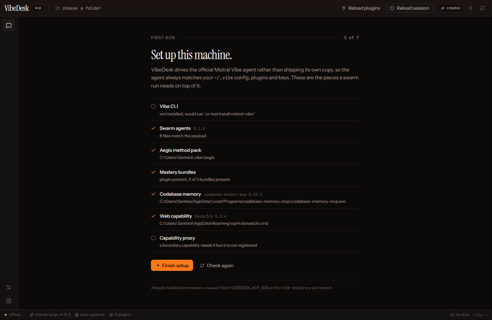
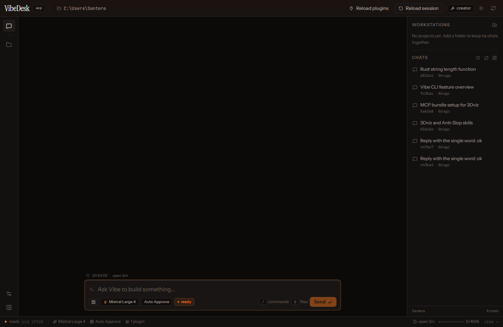
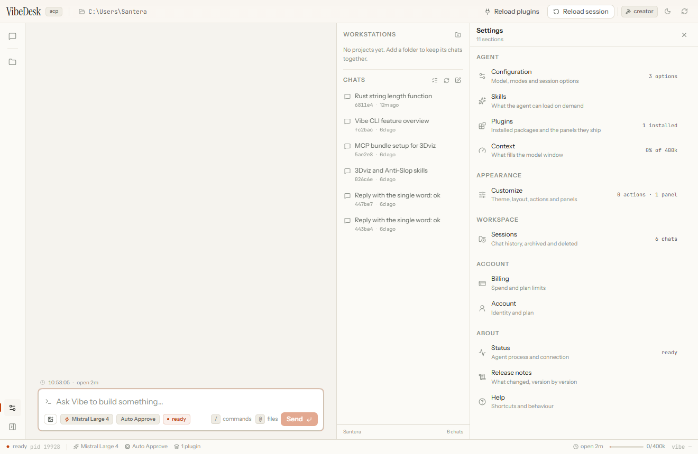

# VibeDesk

A desktop app for the Mistral Vibe agent. VibeDesk wraps the official `vibe-acp`
binary in a Tauri shell and speaks the Agent Client Protocol to it over stdio, so
the UI is a real client of the same agent the `vibe` CLI runs. It does not bundle
or reimplement the agent: your `~/.vibe` config, plugins, skills and keys are the
ones the desktop uses.

```
React 19 + Tailwind v4  <-- JSON-RPC over stdio -->  vibe-acp (Python)
        |                                                      |
        +------ Tauri IPC (invoke + events) --------------------+
                              |
                    Rust bridge (process, fs, terminals,
                    approvals, worktrees, swarm engine)
```

## Why this exists

If you have ever pointed several AI agents at one project, you have hit the same
walls we hit. Runs that hang forever and leave every agent process alive. A stale
binary quietly running old code. A permission popup that refuses an innocent
command because it contains a quoted string. The same task verified twice, temp
folders and git worktrees piling up after every run, and a plan edit that changed
nothing escalating the whole run to a failure.

We hit these while building games with a multi-agent "swarm" harness, three runs
in a row failed for three different reasons, and we fixed each one at its cause
with one regression test per fix. You can read the whole story in
[docs/PLAN-polish.md](docs/PLAN-polish.md). VibeDesk ships that harness built in:
type `/swarm` inside any git repo and a lead agent plans the work, worker agents
implement it in isolated git worktrees, verifier agents try to break each change,
and the engine merges the results in dependency order. Every decision is written
to an append-only board, so you can see exactly what happened and why.

## What you get

- **Chats and workstations.** Chats are grouped by project folder. Add a folder
  once and its chats, context and settings stay together.
- **A status bar that tells the truth.** Agent process state, model, approval
  mode, context usage and spend, all live.
- **Side panels with live data.** Panels are defined in a JSON manifest and can
  show clocks, files, charts and more, with tabs, splits and conditional blocks.
- **Runtime customization.** Themes (ink, paper), layout, actions and panels can
  be changed from the Customize settings. Changes show a diff and a preview
  before they apply, and protected surfaces cannot be edited by accident.
- **Slash commands and actions.** Type `/` for commands, `@` for files, and the
  agent's own messages can contain buttons and forms it asks you to answer.
- **Rich message blocks.** Agents can render charts with axes and legends,
  sandboxed markup, and widgets that run their own scripts from a separate
  origin with their own sandbox rules.
- **Creator mode.** Let the agent build VibeDesk's own interface with you.
- **Billing and usage.** Spend and plan limits from your account, in the app.
- **Plugins and skills.** Everything in `~/.vibe/plugins` and `./.vibe/plugins`
  works, with a Reload plugins button that re-scans and restarts the session if
  anything changed.
- **The swarm.** `/swarm` in a git repo, as described above.

## Screenshots

First run, when the app checks the machine and can install the Vibe CLI for you:



The main window with the workstation rail and the composer:



A custom side panel with a live data source (the epoch counter ticks on its own):


The Settings directory: model and session options, skills, plugins, context,
customization, billing, status, release notes:


The paper theme, switched from the header:



## Install

You need Windows 11 (WebView2 comes with it), Node 20+ and Rust 1.77+ to build
from source, and the Vibe CLI. To get the CLI:

```bash
uv tool install mistral-vibe    # or: pipx install mistral-vibe
```

Then build the app:

```bash
git clone https://github.com/santera-pixel/vibedesk.git
cd vibedesk
npm install
npm run tauri:dev      # dev server + native window
npm run tauri:build    # release build
```

`npm run tauri:build` produces a standalone `vibedesk.exe` plus NSIS and MSI
installers under `src-tauri/target/release/`. The exe is self-contained and runs
without Node. `npm run build` alone runs the TypeScript check and the frontend
build, which is handy when you only touch the UI.

On first launch VibeDesk does not assume anything is installed. A setup screen
checks the machine step by step and offers to install the CLI for you, or shows
the exact command to copy. If the agent binary lives somewhere unusual, point
`VIBEDESK_ACP_BIN` at it and restart.

## Sign in and API keys

VibeDesk has no account system of its own; it inherits yours. Two ways to
connect:

1. **API key.** Add your key to `~/.vibe/.env`:

   ```bash
   MISTRAL_API_KEY=your-key-here
   ```

   Keep `.env` out of git; it is your secret.

2. **Browser sign-in.** Run `vibe` once in a terminal and sign in there. The
   desktop app picks up the same session.

To use another provider, edit `~/.vibe/config.toml` and point the model at the
environment variable that holds its key, for example `api_key_env =
"MISTRAL_API_KEY"`. See the Vibe CLI docs for the full config format.

## Technical details

Architecture, the ACP bridge, session semantics, the swarm engine internals,
installer flags and the full build and test reference live in
[technical.md](technical.md).

## Development

```bash
npm run build                 # tsc --noEmit && vite build
npm test                      # frontend unit tests (node --test)
cd src-tauri && cargo test    # Rust bridge, swarm engine, worktree tests
```

The app can expose a Chrome DevTools Protocol endpoint for live UI checks: start
a debug build with `VIBEDESK_REMOTE_DEBUGGING=9222`, then use
`node scripts/live-check.mjs shot out.png` or `eval "..."` against it.
